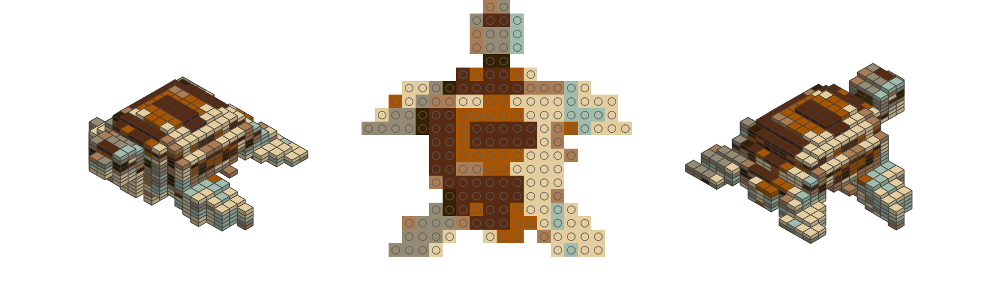

## Méthode
Grille de tenons lue sur la vue de dessus, hauteurs lues sur le profil et la face (enveloppe visuelle), couleurs prises sur chaque vue, puis pavage glouton en plaques.

## Résultat
La silhouette de la tortue est reconnaissable, mais le modèle n'est qu'un **empilement de plaques**, surtout des 1×1, avec un intérieur plein. L'ajout de pentes sur les bords (574 pièces) n'a pas suffi à faire ressembler le résultat à un set.

## Conclusion
Une forme reconstruite puis habillée donnera toujours une sculpture en voxels. **On ne retrouve pas les pièces du concept.**
