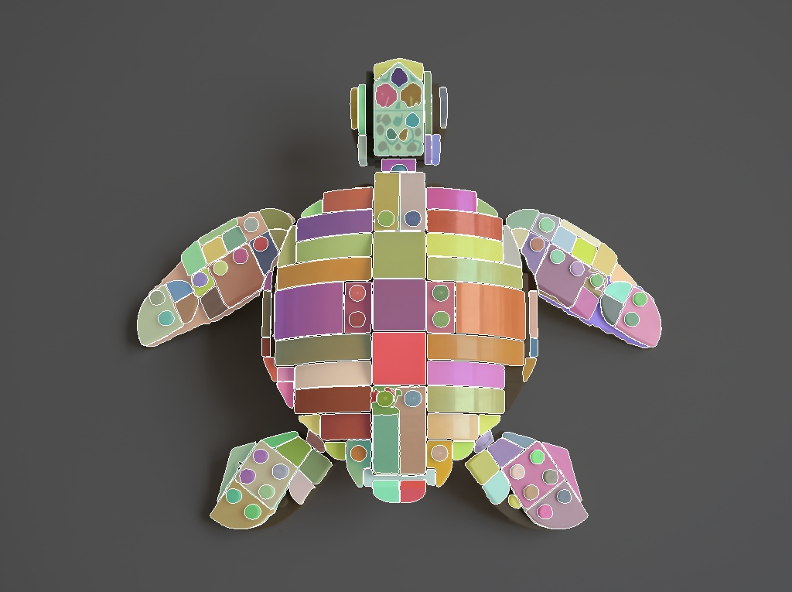
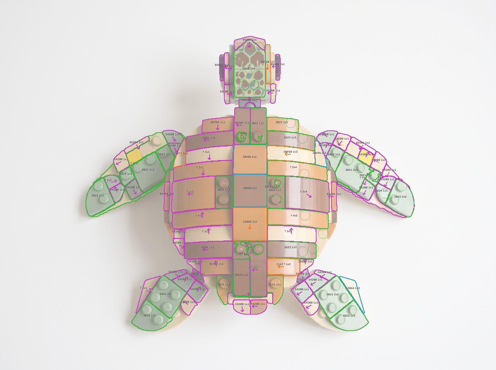

## Méthode
1. Découpage de la vue de dessus en segments avec **SAM** (MobileSAM sur le PC, SAM complet sur le Mac Studio).
2. Identification par règles : emprise en tenons, tenons visibles, dégradé de lumière (pente), forme ronde, couleur.

## Résultat
Le découpage suit bien les pièces de la carapace. L'identification par règles reste fragile : sens des pentes, pièces absentes du catalogue, tête imprimée. L'assemblage 3D automatique construit à partir de ces détections était inutilisable.

## Où le retrouver
Les outils (Annoter, Mesures, Historique) sont dans chaque sujet, rubrique **Archive SAM**.
