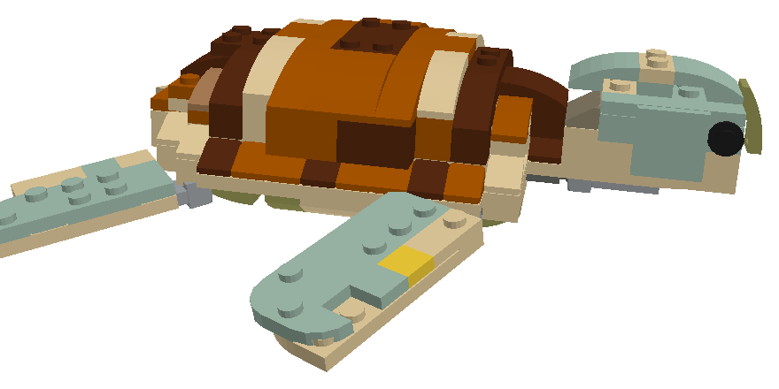

## Méthode
Lecture des vues zone par zone, puis un **script de montage** (`designs/tortue.py`) où chaque pièce est posée par rapport à ses voisines, avec un kit qui mesure les pièces dans la bibliothèque LDraw.

- **Carapace** : colonne centrale, bandes de pentes courbes de couleurs alternées, corniche, dessous en dôme inversé.
- **Tête** : 4 tenons de large, joues, yeux montés de côté, museau en pente courbe debout.
- **Nageoires** : sous-ensembles sur **rotules Joint-8** (22890 + 14418), inclinées autour du centre de la bille.

## Résultat
C'est le modèle le plus proche du concept, mais il a demandé de longues itérations. **Le vérificateur** (`designs/check.py`) garantit qu'aucune pièce ne flotte.

Ouvrir le modèle : [sujet tortue](#/sujet/lego_tortue/modele).
