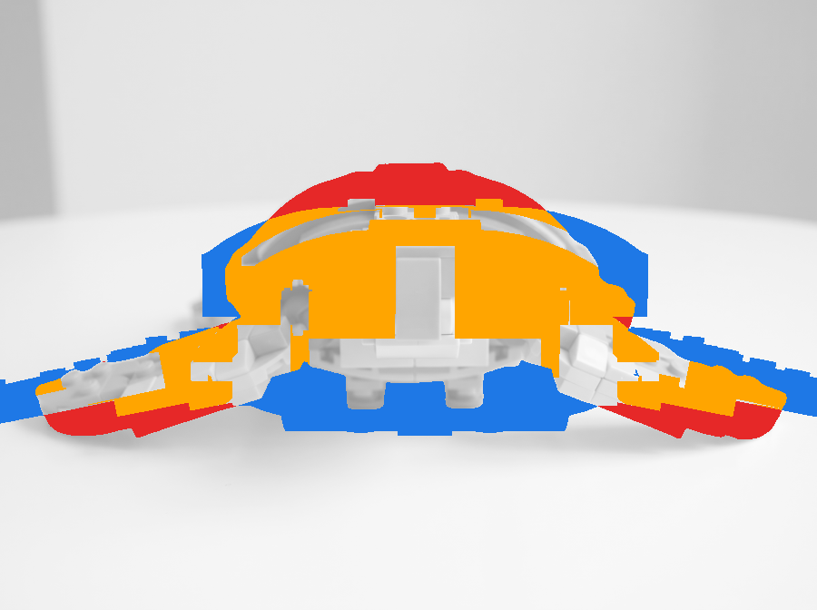

## Méthode
- **Calage de caméra** pour chaque vue : orientation (limitée à ±5° autour de l'angle prévu), distance commune à toutes les vues, focale.
- **Scores** : recouvrement des silhouettes, écart moyen des contours, couleur par zone (indicatif).
- **Optimisation** (`designs/optimize.py`) : les réglages du script (inclinaison et balayage des nageoires, hauteur de la tête…) sont ajustés pour maximiser le score, sous contraintes physiques (pas de pièce flottante, rien sous la table).

## Résultat
Silhouette moyenne de **70 % à 77,8 %**. Le score géométrique ne mesure pas la beauté : un modèle moche peut obtenir le même score.
