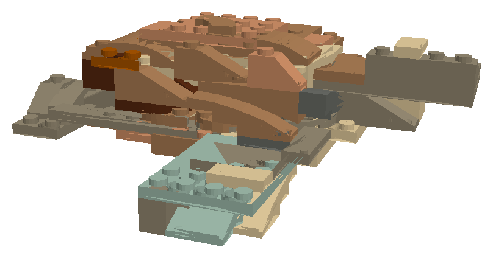

## Méthode
- **Points d'accroche** de chaque pièce lus dans LDraw (`brickforge/connect.py`).
- **Forme cible** sculptée depuis les 6 silhouettes (`brickforge/target.py`).
- À chaque étape, toutes les positions de toutes les pièces sont évaluées ; seuls les gestes réels sont autorisés (emboîtée sur un tenon libre, sans collision).

## Résultat
Même score de silhouette que la tortue conçue à la main, mais **sans intention** : ni symétrie, ni sous-ensembles, ni goût. Il servira à remplir l'intérieur caché des modèles et à générer des données d'entraînement.
