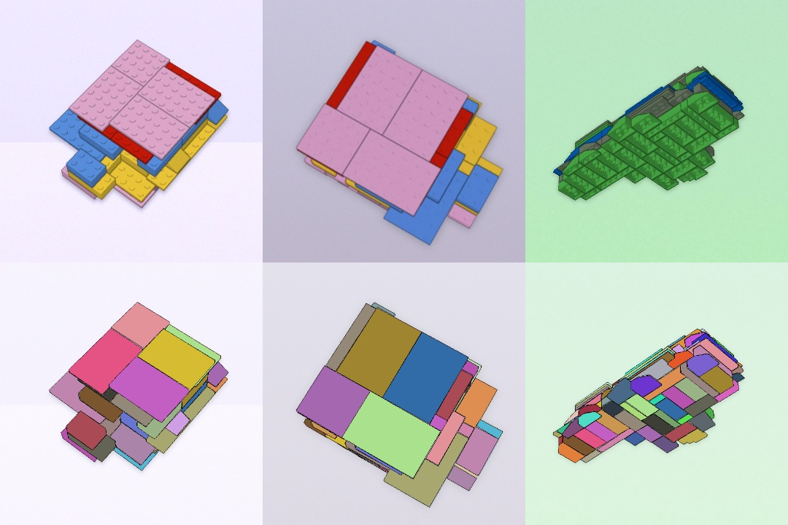

## Pourquoi
Gemini est aujourd'hui le meilleur « concepteur » LEGO. Le maillon manquant, c'est de **lire les pièces** dans ses images.

## Données
`brickforge/synth.py` génère des assemblages valides (moitié formes sculptées, moitié assemblages équilibrés pour que toutes les pièces apparaissent), les rend sous 4 angles et produit **pour chaque pixel la pièce visible**, donc des étiquettes exactes et gratuites.

## Journal
- **Premier lot** arrêté : la répartition des pièces était déséquilibrée (25 000 briques 2×4, 2 tuiles 1×1).
- **Deuxième lot** arrêté : le rendu (algorithme du peintre) laissait des pièces cachées « percer » à travers les autres. Remplacé par un vrai tampon de profondeur.
- **Troisième lot** : entraînement en cours. À la passe 17 : 43 % des pièces trouvées avec un bon contour (mAP50) sur la validation synthétique.
- **Plantage à la passe 18** (mémoire graphique) : une analyse lancée en parallèle sur le Mac Studio, dont la mémoire est partagée CPU/GPU. Entraînement repris ; les analyses sont désormais bloquées pendant l'entraînement.

- **Deuxième plantage** : le Mac Studio est partagé, un autre utilisateur y lance `ollama` (18 à 26 Go de mémoire sur 36). Décision : **on garde le modèle après 18 passes** plutôt que de lutter pour la mémoire.

## Premier test sur les vraies vues Gemini (passe 17)
Le modèle n'a vu que des rendus, jamais de photo. Sur les 6 vues de la tortue, il détecte **50 à 80 pièces par vue**, avec des contours qui suivent bien les bandes de la carapace et les plaques des nageoires. Les références sont souvent de la bonne famille (pentes courbes sur la carapace) mais pas de la bonne longueur : les bandes 4×1 sont prises pour des 2×2.

## Risque principal
L'écart entre nos rendus et les photos Gemini. Parades prévues : affinage sur les vues de la tortue pré-étiquetées avec la conception manuelle, puis conversion des rendus au style photo (ControlNet + LoRA).
