## Pourquoi les BrickHeadz
Le format est toujours le même : un socle, des jambes courtes, un corps, et une grosse tête cubique qui fait la moitié de la hauteur. Le problème n'est plus « inventer une forme en briques », mais « **remplir un gabarit connu** » : les couleurs, la face, les cheveux, les oreilles, les accessoires.

Gemini sait déjà produire de beaux concepts dans ce style. Il **invente toutefois des pièces** :
- **le portrait** : très réussi, mais avec quelques pièces qui n'existent pas ;
- **le chat** : quatre yeux et des pièces inventées ;
- **la danseuse** : beaucoup de pièces hallucinées (col en dentelle, jupe rayée « imprimée », éventail).

La conclusion reste la même que pour la chèvre : **Gemini sert de concept, et la construction doit venir de vraies pièces posées sur un vrai gabarit.**

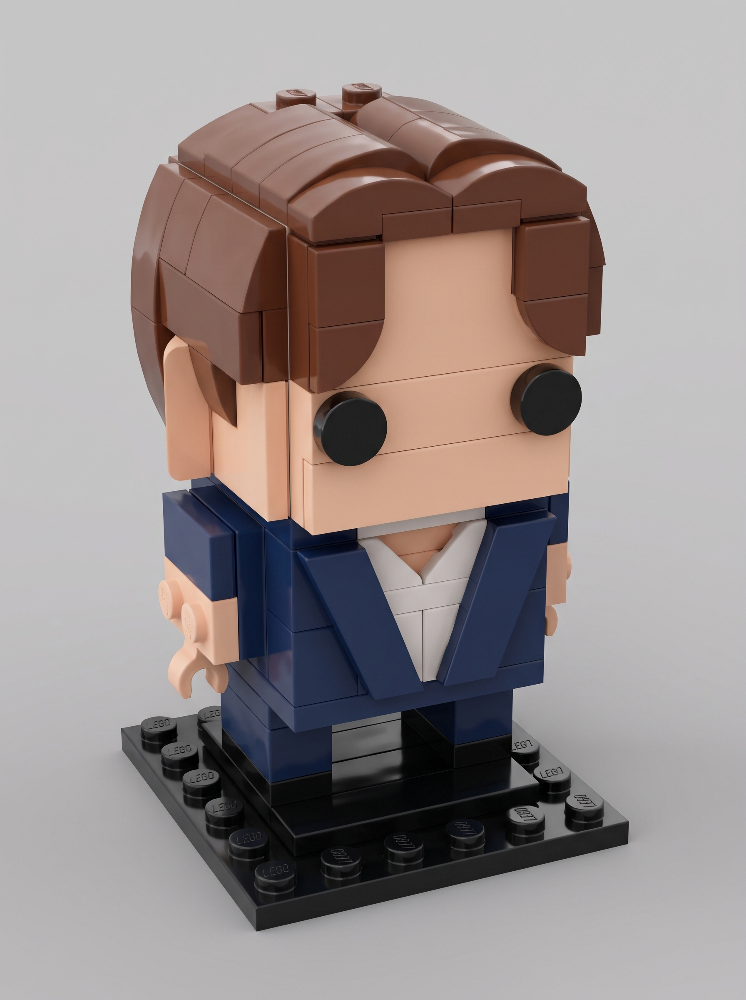
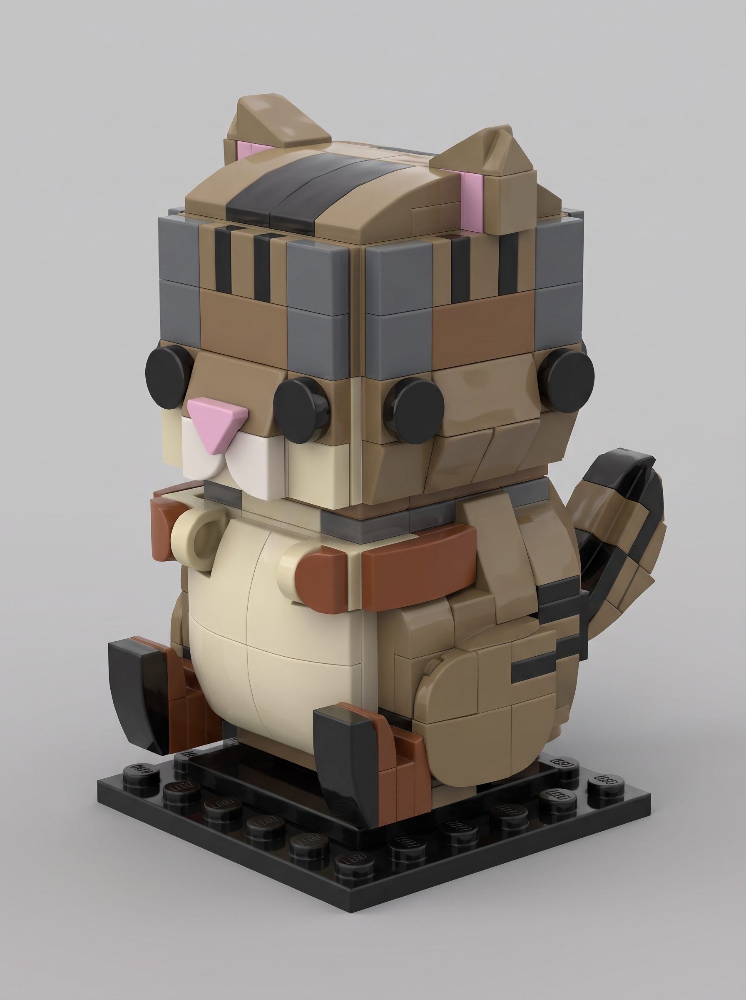
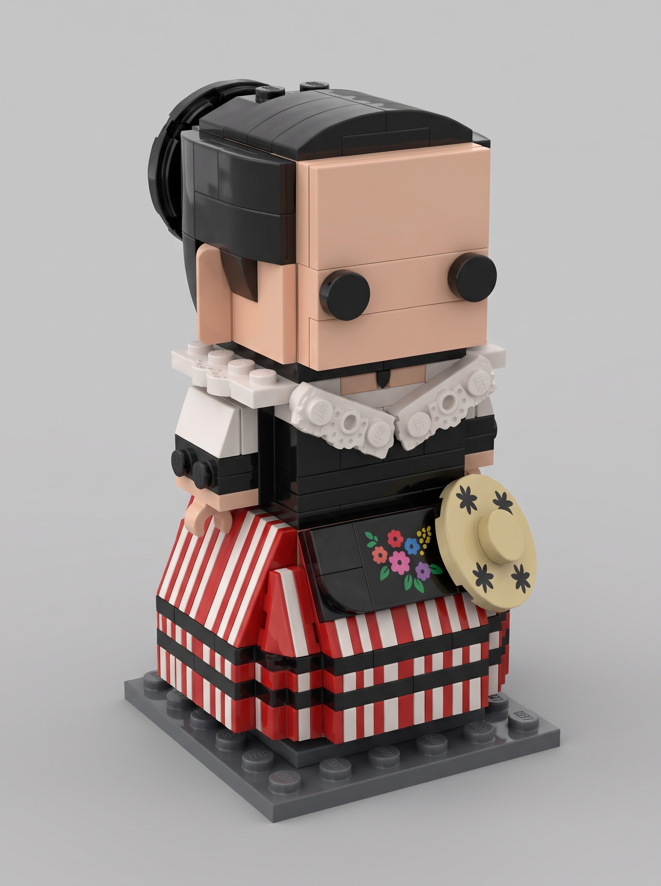

## Données
- Explorateur, filtre « Brickheadz » : **196 sets**, dont **76 avec la 3D et la notice** (OMR, de 2016 à 2021). Les 120 autres (2021 à 2026) n'ont que l'inventaire.
- Analyse : `python -m brickforge.brickheadz`, en 10 s. Elle produit :
  - `data/brickheadz/figures.json` : une entrée par figurine, avec ses pièces placées, recalées et orientées ;
  - `data/brickheadz/grids.npz` : grilles de voxels colorés, 24 × 96 × 24 (demi-tenon × demi-plate) ;
  - `data/brickheadz/stats.json` : les statistiques.
- Traitement de chaque set :
  1. séparer les figurines : un set peut en contenir 2 ou 3 (Mr & Mrs Claus, Elf & Elfie…) ;
  2. orienter la face vers la caméra, grâce aux yeux : tuiles rondes posées à la verticale ;
  3. recaler sur l'axe de la tête et le dessous du socle ;
  4. passer en voxels.
- On obtient **101 figurines**, dont 53 seules dans leur set. 13 ont des décors sur un socle élargi : ce sont les saisonniers (lapin, sorcière, Père Noël…). Les ficelles en segments (la toile de Spider-Man) sont écartées.

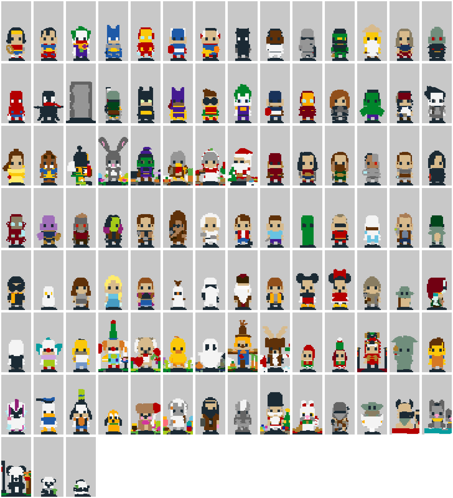

## Le gabarit
La carte de présence montre, pour chaque case, la part des figurines qui y ont de la matière (jaune = presque toutes). À gauche la face, à droite le profil.

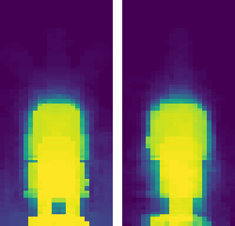

| Mesure | Valeur (médiane) |
|---|---|
| Hauteur totale | **27 plates** (≈ 9 briques), de 13,5 à 42 avec les décors |
| Tête | **6,4 × 6,6 tenons**, de ~12 à ~27 plates de haut |
| Pièces | **119**, de 51 à 250 |
| Socle | plaque 6 × 6 (3958) dans 79 % des figurines, recouverte de tuiles |
| Jambes | ~4,5 tenons de large, de 2 à 5 plates |
| Corps | 6 à 7 tenons, de 6 à 12 plates |

**Le squelette commun** : même pièce, même position et même orientation dans environ 40 à 50 % des figurines.
- **Noyau de la tête** : une colonne de briques 2 × 2 (3003) et une plaque ronde 2 × 2 au centre, entourée de **briques 1 × 2 × 1⅔ à tenons latéraux (22885)** sur trois étages (13, 19 et 24 plates). C'est la pièce clé du format : **1 192 exemplaires, dans 98 % des figurines**. Toute la face et les côtés de la tête s'accrochent sur ses tenons latéraux.
- **Yeux** : deux tuiles rondes 1 × 1 imprimées (98138pz0), à ±1,5 tenon de l'axe, à 17,75 plates de haut, sur le plan de la face. Elles sont dans 50 % des figurines.
- **Bras** : des plaques à clip (11476) à ±2,8 tenons, vers 9 plates de haut.
- **Socle** : une plaque à deux tenons 1 × 4 (92593) et des tuiles 2 × 4 et 1 × 4 aux mêmes places.

**Pièces les plus utilisées** (part des figurines qui les ont) :
- 3023 plaque 1 × 2 (100 %), 2431 tuile 1 × 4 (100 %), 22885 (98 %) ;
- 3003 brique 2 × 2 (91 %), 4032 plaque ronde 2 × 2 (90 %), 87079 tuile 2 × 4 (89 %) ;
- 3069 tuile 1 × 2 (86 %), 3024 plaque 1 × 1 (86 %).

Les 101 figurines utilisent seulement **539 références** au total. C'est un vocabulaire petit et connu, dans lequel le générateur devra rester.

## Ce que ça change pour la suite
1. **Gabarit fixe** : on part du squelette (socle, jambes, noyau de tête en 22885) au lieu de partir de rien.
2. **Représentation** : chaque figurine est une grille de couleurs dans ce gabarit. On a 101 exemples pour apprendre à passer d'un concept à une grille, puis d'une grille à des pièces.
3. **Vocabulaire restreint** : seulement des pièces vues dans les vrais BrickHeadz, donc aucune pièce hallucinée.
4. Étape 2 ci-dessous : les zones qui changent d'un personnage à l'autre.

## Étape 2 : les zones et ce qui y varie
Analyse : `python -m brickforge.brickheadz_zones` (8 s), résultats dans `data/brickheadz/zones.json`.

On découpe le gabarit en **8 zones**, à partir du profil mesuré couche par couche :
- **socle** : de 0 à 2 plates ;
- **jambes** : de 2 à 5 plates, environ 4,5 tenons de large ;
- **corps** : de 5 à 12 plates ;
- **bras** : sur les côtés du corps ;
- **face** : le plan avant de la tête, de 12 à 26 plates ;
- **tête** : les côtés, l'arrière et le noyau ;
- **au-dessus** : au-delà de 26 plates ;
- **hors gabarit** : tout le reste.

Une pièce est dite **visible** si on la voit de l'extérieur, de face, de côté, de derrière ou de dessus.

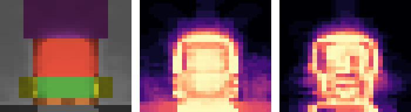

À gauche, les zones : gris = socle, bleu = jambes, vert = corps, jaune = bras, rouge = face/tête, violet = au-dessus. Au centre et à droite, ce qui varie le plus en forme, du noir (fixe) au jaune clair (très variable) : les **bords de la tête**, le dessus et les côtés. Le cœur du gabarit, lui, ne bouge pas.

| Zone | Présente | Pièces (dont visibles) | Couleurs | Références vues | Pièces typiques visibles |
|---|---|---|---|---|---|
| Socle | 100 % | 4 (3) | 1 | 47 | plaque 6 × 6, plaque 1 × 4 à 2 tenons, tuiles 1 × 4 / 2 × 4 |
| Jambes | 100 % | 6 (4) | 2 | 60 | plaques 1 × 2 (3023), tuiles 1 × 1, briques 1 × 2 |
| Corps | 100 % | 29 (18) | 4 | 247 | plaques à clip (bras), tuiles 1 × 2, plaques 4 × 4 / 2 × 4, pentes courbes |
| Bras | 37 % | — | — | 73 | plaques 1 × 1, fleurs (mains), pentes 1 × 1 |
| Face | 97 % | 13 (9) | 3 | 144 | tuiles 1 × 4 / 2 × 4, **yeux 98138pz0/pz1**, coins arrondis 1 × 1, pentes courbes |
| Tête (côtés, arrière) | 100 % | 50 (26) | 3 | 154 | tuiles 1 × 2 / 2 × 4, pentes 31° et courbes |
| Au-dessus | 44 % | — | — | 82 | pentes 1 × 1 / 2 × 1 / 2 × 2 courbes, briques à arrondi |
| Hors gabarit | 50 % | — | — | 142 | plaques rondes 1 × 1, pentes, fleurs (accessoires, décors) |

**Structure et habillage.** En médiane, **41 % des pièces sont cachées à l'intérieur**. Ce sont presque toujours les mêmes :
- 22885 (98 figurines), plaques 1 × 2, briques 2 × 2, plaques rondes 2 × 2, plaques 2 × 2 / 2 × 4 / 4 × 4 ;
- des tuiles posées en dessous, qui servent de glissières pour le montage en SNOT.

Le travail se découpe donc en deux :
1. **la structure**, presque fixe, se reprend du squelette appris ;
2. **l'habillage**, environ 60 % des pièces, est ce qu'il faut choisir à partir du concept : surtout des tuiles, des pentes et des plaques, en quelques couleurs par zone.

**La face est une petite image en pixels.** Vue de face, la tête fait environ **14 × 11 cases** (demi-tenons × 1¼ plate), avec **4 couleurs** en médiane.

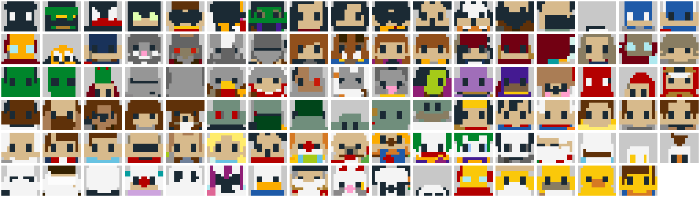

La carte ci-dessous montre où la face s'écarte de sa couleur dominante, du violet (rarement) à l'orange (souvent) :

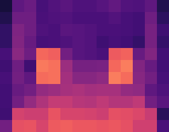

- **Yeux** : toujours aux mêmes cases (rangées 5 à 7, colonnes 4-5 et 10-11), dans 65 à 73 % des figurines. Le reste correspond à des yeux intégrés à un masque ou à un casque.
- **Frange / cheveux** : le haut de la face diffère dans environ 25 % des cas.
- **Bas de la face** : bouche, barbe, col, menton. C'est la zone la plus variable, de 50 à 65 %.
- Les bords gauche et droit sont presque toujours de la couleur de la tête.

**Ce qui dépasse.** 47 figurines ont quelque chose au-dessus de la tête (cheveux, chapeau, oreilles), dont 7 avec des oreilles ou des cornes séparées : Mickey, Batman, Batgirl, le chat, le berger allemand, le renne… La moitié ont des pièces hors gabarit : accessoires, décors du socle.

**Conséquence pour le générateur.** Un BrickHeadz se décrit avec peu de choses :
1. une **couleur par zone** (socle, jambes, corps, tête) ;
2. une **image de face de 14 × 11** avec deux yeux à des places fixes ;
3. des **options** : cheveux ou chapeau, oreilles, bras, accessoire.

On n'a plus de forme libre à inventer. Le concept Gemini sert à remplir cette fiche, et la fiche se traduit en pièces avec le vocabulaire de chaque zone.

## Étape 3 : construire à partir d'une fiche (v1, « greffe »)
Script : `python -m brickforge.bh_build` (validation croisée, 20 s) et `python -m brickforge.bh_build 40377-1 0` (une figurine, exportée en `.mpd` et en sujet de l'app). Résultats dans `data/brickheadz/rebuild_eval.json`.

**La fiche** : la figurine vue de face, de dos, de gauche, de droite et de dessus, en cases de 10 LDU et en couleurs LDraw, dans le repère du gabarit. S'y ajoutent les options : quelque chose au-dessus de la tête, des oreilles.

**La construction v1** se fait en trois temps :
1. **Choisir le gabarit** : on prend le vrai BrickHeadz dont la silhouette, de face et de profil, ressemble le plus à la fiche. Il est donc constructible par construction.
2. **Recolorer** chaque pièce visible par un vote. Chaque case de la pièce visible depuis une direction lit la vue correspondante de la fiche ; la face pèse le plus. Si la couleur gagnante n'existe pas pour cette pièce dans un vrai set (inventaires Rebrickable), on prend la suivante.
3. **Retirer** les pièces du gabarit qui tombent hors de la silhouette, seulement au-dessus de la tête ou hors gabarit, donc sans toucher à ce qui porte le reste.

**Le test** : chaque figurine officielle est reconstruite depuis sa propre fiche, mais avec le gabarit d'une autre figurine. Les gabarits du même personnage sont interdits : Captain America apparaît dans deux sets, il ne doit pas se servir de lui-même.

| Mesure (médiane, 101 figurines) | Résultat |
|---|---|
| Silhouette du gabarit choisi (IoU face + profil) | 0,89 |
| **Face : pixels de la bonne couleur** | **74 %** (moitié centrale : 64 à 82 %) |
| Même gabarit sans recoloration | 16 % |
| **Couples (pièce, couleur) qui existent dans un vrai set** | **99,2 %** |

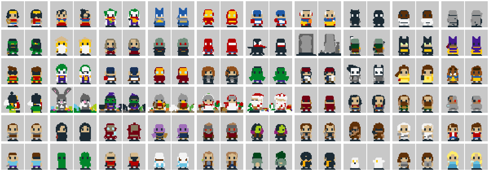

- **Ce qui marche bien** : les personnages au format standard (Rey 92 %, Stormtrooper 91 %, Iron Man 90 %, Supergirl…). Les couleurs, les cheveux, les yeux, la tenue et les bandes se retrouvent bien.
- **Ce qui marche mal** : les silhouettes rares, comme les saisonniers et leurs décors (épouvantail 47 %, clown, renne, ours, Lucky Cat ~50 %). Aucun autre gabarit n'a la même forme.
- **Donald**, reconstruit sur le gabarit d'un Batman :
  - la face est juste à 78 % : tête blanche, yeux, bec et pieds orange, chemise bleue ;
  - le **volume manque** : le bec est plat, et le chapeau reprend la forme des oreilles de chauve-souris (elles tombent exactement dans la silhouette du chapeau) ;
  - pour comparer, deux sujets : « Bh Donald Duck V1 » (reconstruit) et « Bh Donald Duck Officiel ».
- **Les couples pièce-couleur qui n'existent pas** (0,8 %) : surtout des pièces dont aucune couleur du vote n'existe. Par exemple une brique 2 × 2 en rouge transparent, ou des fleurs en gris foncé.
- **Correction dans l'app** : l'afficheur 3D ne connaissait qu'une palette réduite et dessinait les autres couleurs en gris (le bec de Donald). Il utilise maintenant toutes les couleurs LDraw.

**Ce que ça montre** : la fiche et un vrai gabarit suffisent déjà pour les **couleurs**, sans aucune pièce inventée. Il reste deux problèmes :
- **la forme** : les éléments qui dépassent du gabarit (bec, oreilles, chapeau, queue) ;
- **le détail de la face**, limité par le découpage des pièces du gabarit.

Pistes pour la v2 :
1. Greffer des **modules** pris sur d'autres figurines : un bec, des oreilles, un chapeau, venant de la figurine qui a la meilleure forme pour cette zone.
2. **Retailler la face** en mosaïque sur les tenons latéraux des briques 22885.

## Étape 3 v2 : construire la forme (modules par zone + comblement)
Script : `python -m brickforge.bh_build2` (validation croisée v1 / v2, environ 1 min) et `python -m brickforge.bh_build2 40377-1 0` (Donald v2 → sujet « Bh Donald Duck V2 »). Résultats dans `data/brickheadz/rebuild_v2_eval.json`.

Ce qui change par rapport à la v1 :
1. **Modules par zone.** Il y a quatre zones « qui dépassent » :
   - **devant** la face : bec, museau, nez ;
   - **dessus** : chapeau, cheveux ;
   - **côtés** : oreilles, au-delà de 4 tenons de l'axe ;
   - **arrière** : chignon, queue.

   Pour chacune, on greffe le module d'une autre figurine s'il colle mieux au volume déduit des vues de la fiche (petit décalage permis, en plates entières). Il faut aussi qu'il ne heurte rien et qu'il touche le reste.
2. **Comblement.** Des plaques 1 × 1 à 1 × 4 sont posées couche par couche, seulement sur une couche déjà pleine, là où la fiche a de la matière et le modèle non.
3. **Pièces cachées.** Elles prennent la couleur de leurs voisines visibles, si elle existe pour la pièce : plus de noyau gris qui se voit en biais.
4. **Mesures de forme** : volume 3D comparé au vrai modèle (IoU), et silhouettes de face, de profil et de dessus.

| Médiane (101 figurines) | v1 | v2 |
|---|---|---|
| Volume 3D (IoU avec le vrai) | 0,83 | 0,82 |
| Silhouette de profil | 0,86 | **0,88** |
| Silhouette de face / dessus | 0,90 / 0,86 | 0,90 / 0,86 |
| Face : pixels justes | 74 % | **76 %** |
| (pièce, couleur) réelles | 99,2 % | 99,4 % |
| Pièces | 115 | 131 |

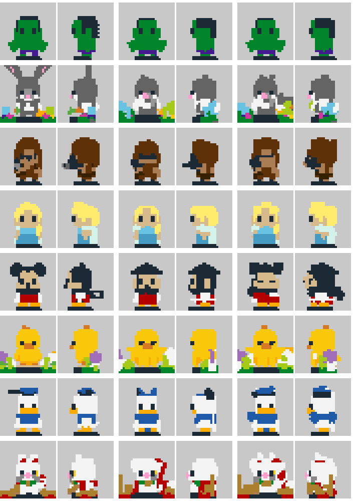

**Bilan honnête.**
- **Ce qui progresse** : les profils et quelques figurines nettement.
  - **Donald v2** : le chapeau est plat avec son bandeau noir au lieu des oreilles de Batman. Le bec orange **avance en relief** : c'est le museau du raptor Blue, greffé puis recoloré. La tête est blanche sur les côtés.
  - **Lucky Cat** récupère des oreilles (face 54 % → 63 %), Chewbacca gagne en face (72 % → 80 %).
- **Ce qui ne progresse pas : le volume 3D.**
  - 21 figurines s'améliorent et 33 se dégradent, autour de 0,82 en médiane.
  - Le volume déduit des vues remplit les creux : le comblement ajoute alors de la matière là où le vrai modèle est vide (jusqu'à +150 plaques pour l'Ours).
  - Certaines greffes sont absurdes : le museau du Mandalorien sur le chat, des oreilles « en bataille » pour Mickey.
- **Défauts visibles sur Donald v2** : une pièce ronde bleue reste à côté du bec (fin du museau de Blue), et un panneau blanc vertical apparaît sur un côté (greffé depuis l'Abeille).

**Ce que ça apprend.** Recycler des morceaux d'autres figurines atteint vite son plafond : seulement 100 figurines, et des formes uniques comme un bec ou un béret. Le comblement « à l'aveugle » depuis les vues est trop grossier. Pour aller plus loin, il faut **construire les volumes avec de vraies pièces choisies pour la forme** : des pentes et des pentes courbes pour un bec, une visière de chapeau. Il faut aussi juger chaque ajout sur la **forme 3D attendue**, et pas seulement sur la silhouette.

## Moteur de constructibilité (`brickforge/buildcheck.py`)

**Question posée** : un modèle est-il montable, c'est-à-dire sans pièce qui vole et sans pièce qui en traverse une autre ?

**Comment il juge.**
1. **Points d'accroche réels de chaque pièce.**
   - Ils viennent de la bibliothèque d'accroches de LDCad (*shadow library*, CC BY-SA) : tenons, tubes, trous, clips.
   - Les tubes LDraw sont ajoutés comme accroches femelles.
   - Si une pièce n'a rien de déclaré, on prend sa face du dessous.
2. **Connexion.**
   - Il faut un mâle et une femelle sur le même axe, qui se recouvrent d'au moins 1 LDU.
   - Une pièce **vole** si elle n'est pas reliée à la plaque de base par une chaîne de connexions.
3. **Collision.**
   - Chaque pièce est voxelisée en plein, à 1 LDU près.
   - Deux pièces non connectées qui s'interpénètrent de plus de 1 LDU sur au moins 30 voxels sont en collision.

**Étalonnage sur les 101 figurines officielles**, qui sont montables par définition :

| | Résultat |
|---|---|
| Figurines jugées sans défaut | 69 / 101 |
| Pièces faussement « volantes » | 343 / 12 071 (2,8 %), dont 156 dans Han Solo en carbonite |
| Figurines avec une fausse collision | 8 |

Le moteur est donc **un peu trop sévère**. Ses fausses alertes viennent de pièces dont les accroches sont mal décrites, par exemple les pièces imprimées ou rares.

**Ce qu'il a révélé.** Il a confirmé ce qu’on voyait à l’œil : la v2 précédente faisait voler **3 398 pièces** et n'avait que 2 figurines sur 101 sans défaut.

**Correctifs appliqués à la v2.**
- Une greffe n'est acceptée que si elle **s'accroche** au reste par au moins une vraie connexion et chevauche moins de 12 %.
- Le comblement ne pose des plaques que sur des tenons libres.
- Une **réparation finale** retire tout ce qui vole encore ou se chevauche.

| 101 figurines | officiel | v1 | v2 (avec moteur) |
|---|---|---|---|
| Sans défaut selon le moteur | 69 | 82 | **101** |
| Pièces qui volent | 343 | 142 | **0** |
| Avec collision | 8 | 5 | **0** |
| Volume 3D (IoU, médiane) | — | 0,83 | 0,83 |
| Face : pixels justes | — | 74 % | 74 % |

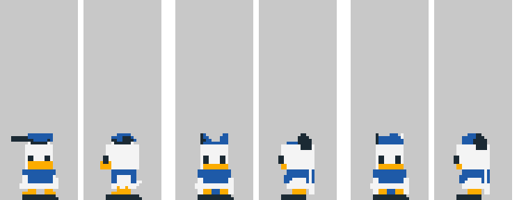

**Bilan honnête.**
- **Le moteur fait son travail**, mais il **vide la v2 de ce qu'elle apportait**.
  - Presque aucune greffe ne trouve d'accroche réelle : 6 figurines sur 101 gagnent des pièces.
  - La v2 redevient une v1 nettoyée.
- **Donald v2** garde un seul ajout, le dessus de chapeau pris sur la Dinde. Il **perd son bec en relief** : le museau de Blue ne tenait sur rien.
- **La réparation peut abîmer une figurine.** Le Capitaine Armando Salazar passe de 91 à 43 pièces quand on retire ses pièces volantes.
- **Conclusion** : coller des morceaux est une impasse pour la forme. Il faut **poser les pièces une à une**, chacune sur des tenons libres, en visant la forme 3D attendue. C'est la direction de l'étape suivante.

## Étape 4 : construire couche par couche, à partir de rien (`brickforge/bh_layer.py`)

**Pourquoi changer.** Greffer sur une figurine finie ne marche pas : presque tous les tenons y sont déjà pris, donc les ajouts ne tiennent sur rien.

**Méthode.** On construit comme on monte un set, de bas en haut :
1. **La cible** est un volume en cases d'un tenon × une plate × un tenon, avec une couleur par case de surface.
   - Cible « 3D » : le volume du vrai modèle. C'est une borne haute, qui répond à la question « sait-on construire une forme donnée ? ».
   - Cible « fiche » : le volume déduit des 5 vues, comparable à v1 et v2.
2. **Chaque couche** est couverte de plaques et de briques réelles (14 plaques, 11 briques, dans les 2 orientations).
   - Une pièce doit poser sur au moins un tenon de la couche du dessous.
   - On préfère les grandes pièces, celles qui chevauchent plusieurs pièces du dessous (joints décalés) et celles qui portent une case en surplomb.
3. **Les surplombs restants** sont repris dans une passe descendante : la pièce s'accroche sous la couche du dessus.
4. **Les blocs qui ne touchent pas le sol** sont retirés.
5. **Couleurs** : chaque pièce prend une seule couleur visible. Les pièces cachées prennent la couleur visible la plus proche. Chaque couple (pièce, couleur) doit exister dans un vrai set.

**Résultats sur les 101 figurines** (médianes) :

| | v1 (greffe) | couches, cible 3D | couches, cible fiche |
|---|---|---|---|
| Sans défaut (moteur) | 82 | **101** | **101** |
| Pièces qui volent / collisions | 142 / 5 | **0 / 0** | **0 / 0** |
| Volume 3D (IoU) | **0,83** | 0,77 | 0,71 |
| Silhouette face / profil / dessus | 0,90 / 0,86 / 0,86 | 0,85 / 0,85 / 0,84 | 0,86 / 0,85 / 0,85 |
| Face : pixels justes | **74 %** | 64 % | 59 % |
| Pièces (officiel : 119) | 115 | 143 | 114 |
| Cases cibles non couvertes | — | 15 | 24 |

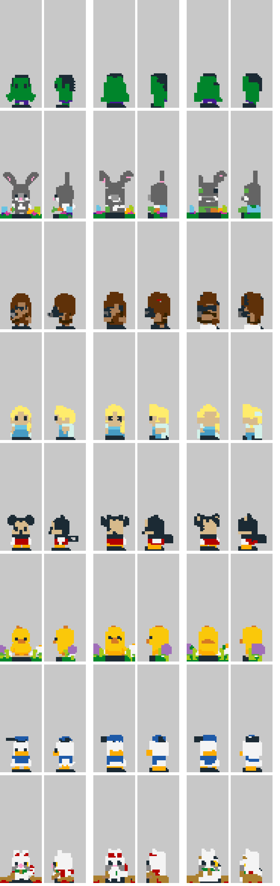

**Bilan honnête.**
- **Ce qui marche.**
  - Tout est montable par construction : 101 sur 101, rien ne vole.
  - La **forme est libre** : le bec de Donald avance, les oreilles du lapin et de Mickey, la visière sont construits sans dépendre d'une autre figurine.
  - Le calcul est rapide, environ 2 s par figurine.
- **Les chiffres restent sous la v1.** C'est normal en partie : la v1 *est* un vrai BrickHeadz recoloré, donc elle colle par nature aux mesures prises sur un vrai BrickHeadz.
- **Ce qui manque.**
  - **Résolution d'un tenon** : les détails d'un demi-tenon disparaissent, comme les yeux (tuiles rondes 1×1) ou les tuiles de côté. Les vraies BrickHeadz font la face avec des briques à tenons sur le côté (22885), à une résolution plus fine.
  - **Couleurs de la cible fiche** : une case de surface prend la couleur de la vue qui la voit. Quand le volume déduit des vues est trop gros, des couleurs de côté débordent, par exemple le lapin vert.
  - Il reste des cases non couvertes (surplombs sans appui), et il n'y a pas encore de pentes ni de tuiles lisses.
- **Pour la suite.**
  1. Face en briques à tenons sur le côté, avec de vrais yeux.
  2. Pentes et tuiles pour les bords.
  3. Le générateur devient l'**usine à données** pour entraîner un modèle « prochaine pièce » (façon BrickGPT, arXiv 2505.05469) : des milliers de figurines montables, chacune avec son image et son ordre de pose.

## Limites
- Les 76 sets en 3D s'arrêtent en 2021. Les 120 plus récents n'ont que l'inventaire, mais celui-ci reste utile pour vérifier qu'on garde le bon vocabulaire de pièces.
- Zones : les frontières sont fixes. Les figurines très hautes (saisonniers, Goofy) débordent dans « au-dessus » et « hors gabarit ».
- La « position identique » ne capte que le squelette exact. Les variantes (tête plus large, chapeau) le décalent, d'où les ~45 % au lieu de ~90 %.
