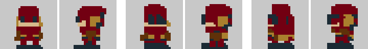
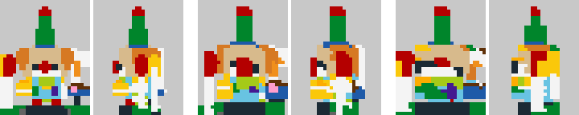
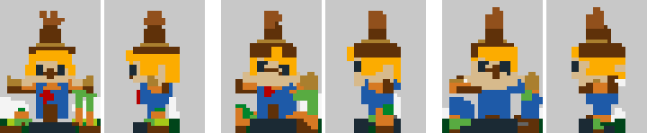

Méthode et chiffres : note **09 · Focus BrickHeadz**, section « Étape 4 ». Ici, uniquement les images.

**En 3D** : clique sur une image (ou choisis dans la liste) pour voir les trois modèles côte à côte ; ils tournent ensemble.

Dans chaque image, de gauche à droite : **officiel** (face, profil) · **couches, cible 3D** (face, profil) · **couches, cible fiche** (face, profil).

Pour chaque figurine : pièces (officiel → cible 3D → cible fiche), puis volume 3D et pixels justes de la face pour la cible 3D.

### Superman & Wonder Woman (1/2) · 41490-1 · 2016

Pièces : 109 → 161 → 156 · volume 0.742 · face 60 %

### Superman & Wonder Woman (2/2) · 41490-1 · 2016

Pièces : 101 → 113 → 109 · volume 0.769 · face 62 %

### Batman & The Joker (1/2) · 41491-1 · 2016

Pièces : 115 → 149 → 143 · volume 0.785 · face 57 %

### Batman & The Joker (2/2) · 41491-1 · 2016

Pièces : 91 → 120 → 81 · volume 0.76 · face 63 %

### Iron Man & Captain America (1/2) · 41492-1 · 2016

Pièces : 98 → 141 → 128 · volume 0.775 · face 60 %

### Iron Man & Captain America (2/2) · 41492-1 · 2016

Pièces : 76 → 112 → 81 · volume 0.785 · face 66 %

### Black Panther & Dr. Strange (1/2) · 41493-1 · 2016

Pièces : 105 → 122 → 106 · volume 0.78 · face 64 %

### Black Panther & Dr. Strange (2/2) · 41493-1 · 2016

Pièces : 62 → 97 → 61 · volume 0.782 · face 72 %

### Finn · 41485-1 · 2017

Pièces : 91 → 109 → 107 · volume 0.782 · face 66 %

### Captain Phasma · 41486-1 · 2017

Pièces : 127 → 115 → 65 · volume 0.796 · face 68 %

### Lloyd · 41487-1 · 2017

Pièces : 102 → 137 → 98 · volume 0.772 · face 56 %

### Master Wu · 41488-1 · 2017

Pièces : 89 → 134 → 75 · volume 0.76 · face 67 %

### Supergirl & Martian Manhunter (1/2) · 41496-1 · 2017

Pièces : 127 → 134 → 113 · volume 0.784 · face 57 %

### Supergirl & Martian Manhunter (2/2) · 41496-1 · 2017

Pièces : 104 → 98 → 101 · volume 0.764 · face 68 %

### Spider-Man & Venom (1/2) · 41497-1 · 2017

Pièces : 77 → 92 → 86 · volume 0.773 · face 64 %

### Spider-Man & Venom (2/2) · 41497-1 · 2017

Pièces : 74 → 90 → 74 · volume 0.719 · face 66 %

### Boba Fett & Han Solo in Carbonite (1/2) · 41498-1 · 2017

Pièces : 172 → 162 → 172 · volume 0.742 · face 80 %

### Boba Fett & Han Solo in Carbonite (2/2) · 41498-1 · 2017

Pièces : 157 → 177 → 173 · volume 0.776 · face 62 %

### Batman · 41585-1 · 2017

Pièces : 91 → 93 → 36 · volume 0.783 · face 77 %

### Batgirl · 41586-1 · 2017

Pièces : 99 → 130 → 108 · volume 0.766 · face 67 %

### Robin · 41587-1 · 2017

Pièces : 101 → 151 → 103 · volume 0.769 · face 59 %

### The Joker · 41588-1 · 2017

Pièces : 151 → 142 → 114 · volume 0.751 · face 58 %

### Captain America · 41589-1 · 2017

Pièces : 79 → 103 → 105 · volume 0.769 · face 53 %

### Iron Man · 41590-1 · 2017

Pièces : 96 → 105 → 81 · volume 0.788 · face 65 %

### Black Widow · 41591-1 · 2017

Pièces : 143 → 167 → 96 · volume 0.765 · face 62 %

### The Hulk · 41592-1 · 2017

Pièces : 93 → 111 → 79 · volume 0.727 · face 71 %

### Captain Jack Sparrow · 41593-1 · 2017

Pièces : 109 → 159 → 141 · volume 0.743 · face 53 %

### Captain Armando Salazar · 41594-1 · 2017

Pièces : 118 → 155 → 150 · volume 0.708 · face 60 %

### Belle · 41595-1 · 2017

Pièces : 139 → 136 → 101 · volume 0.814 · face 77 %

### Beast · 41596-1 · 2017

Pièces : 116 → 146 → 122 · volume 0.773 · face 61 %

### Bee · 40270-1 · 2018

Pièces : 112 → 148 → 227 · volume 0.612 · face 52 %

### Bunny · 40271-1 · 2018

Pièces : 126 → 180 → 152 · volume 0.725 · face 66 %

### Witch · 40272-1 · 2018

Pièces : 149 → 208 → 176 · volume 0.785 · face 62 %

### Turkey · 40273-1 · 2018

Pièces : 114 → 191 → 211 · volume 0.731 · face 59 %

### Mr. Claus & Mrs. Claus (1/2) · 40274-1 · 2018

Pièces : 180 → 215 → 233 · volume 0.741 · face 56 %

### Mr. Claus & Mrs. Claus (2/2) · 40274-1 · 2018

Pièces : 161 → 263 → 221 · volume 0.767 · face 62 %

### The Flash · 41598-1 · 2018

Pièces : 122 → 148 → 119 · volume 0.758 · face 62 %

### Wonder Woman · 41599-1 · 2018

Pièces : 143 → 169 → 152 · volume 0.804 · face 66 %

### Aquaman · 41600-1 · 2018

Pièces : 135 → 153 → 99 · volume 0.746 · face 59 %

### Cyborg · 41601-1 · 2018

Pièces : 108 → 139 → 113 · volume 0.77 · face 64 %

### Rey · 41602-1 · 2018

Pièces : 119 → 134 → 113 · volume 0.79 · face 64 %

### Kylo Ren · 41603-1 · 2018

Pièces : 130 → 101 → 92 · volume 0.788 · face 80 %

### Iron Man MK50 · 41604-1 · 2018

Pièces : 101 → 153 → 118 · volume 0.735 · face 61 %

### Thanos · 41605-1 · 2018

Pièces : 105 → 134 → 98 · volume 0.781 · face 65 %

### Star-Lord · 41606-1 · 2018

Pièces : 113 → 141 → 86 · volume 0.773 · face 60 %

### Gamora · 41607-1 · 2018

Pièces : 136 → 148 → 141 · volume 0.804 · face 71 %

### Han Solo · 41608-1 · 2018

Pièces : 141 → 138 → 103 · volume 0.796 · face 61 %

### Chewbacca · 41609-1 · 2018

Pièces : 149 → 177 → 171 · volume 0.77 · face 62 %

### Marty McFly & Doc Brown (1/2) · 41611-1 · 2018

Pièces : 123 → 174 → 145 · volume 0.79 · face 63 %

### Marty McFly & Doc Brown (2/2) · 41611-1 · 2018

Pièces : 117 → 138 → 127 · volume 0.786 · face 66 %

### Steve & Creeper (1/2) · 41612-1 · 2018

Pièces : 80 → 101 → 102 · volume 0.776 · face 62 %

### Steve & Creeper (2/2) · 41612-1 · 2018

Pièces : 80 → 106 → 56 · volume 0.776 · face 74 %

### Mr. Incredible & Frozone (1/2) · 41613-1 · 2018

Pièces : 83 → 105 → 115 · volume 0.776 · face 61 %

### Mr. Incredible & Frozone (2/2) · 41613-1 · 2018

Pièces : 77 → 110 → 96 · volume 0.78 · face 70 %

### Owen & Blue (1/2) · 41614-1 · 2018

Pièces : 120 → 165 → 138 · volume 0.801 · face 61 %

### Owen & Blue (2/2) · 41614-1 · 2018

Pièces : 114 → 150 → 103 · volume 0.775 · face 72 %

### Harry Potter & Hedwig (1/2) · 41615-1 · 2018

Pièces : 119 → 137 → 142 · volume 0.758 · face 66 %

### Harry Potter & Hedwig (2/2) · 41615-1 · 2018

Pièces : 61 → 59 → 27 · volume 0.727 · face 71 %

### Hermione Granger · 41616-1 · 2018

Pièces : 127 → 103 → 115 · volume 0.744 · face 68 %

### Elsa · 41617-1 · 2018

Pièces : 130 → 122 → 123 · volume 0.827 · face 71 %

### Anna & Olaf (1/2) · 41618-1 · 2018

Pièces : 130 → 123 → 133 · volume 0.824 · face 67 %

### Anna & Olaf (2/2) · 41618-1 · 2018

Pièces : 71 → 54 → 33 · volume 0.726 · face 67 %

### Stormtrooper · 41620-1 · 2018

Pièces : 124 → 146 → 97 · volume 0.785 · face 73 %

### Ron Weasley & Albus Dumbledore (1/2) · 41621-1 · 2018

Pièces : 138 → 143 → 131 · volume 0.79 · face 66 %

### Ron Weasley & Albus Dumbledore (2/2) · 41621-1 · 2018

Pièces : 107 → 153 → 125 · volume 0.782 · face 62 %

### Mickey Mouse · 41624-1 · 2018

Pièces : 109 → 138 → 110 · volume 0.755 · face 70 %

### Minnie Mouse · 41625-1 · 2018

Pièces : 129 → 159 → 116 · volume 0.764 · face 72 %

### Luke Skywalker & Yoda (1/2) · 41627-1 · 2018

Pièces : 134 → 149 → 137 · volume 0.776 · face 68 %

### Luke Skywalker & Yoda (2/2) · 41627-1 · 2018

Pièces : 80 → 65 → 68 · volume 0.713 · face 53 %

### Jack Skellington & Sally (1/2) · 41630-1 · 2018

Pièces : 122 → 190 → 146 · volume 0.797 · face 69 %

### Jack Skellington & Sally (2/2) · 41630-1 · 2018

Pièces : 71 → 112 → 99 · volume 0.795 · face 75 %

### Homer Simpson & Krusty the Clown (1/2) · 41632-1 · 2018

Pièces : 118 → 144 → 112 · volume 0.78 · face 65 %

### Homer Simpson & Krusty the Clown (2/2) · 41632-1 · 2018

Pièces : 99 → 133 → 86 · volume 0.784 · face 68 %

### Birthday Clown · 40348-1 · 2019

Pièces : 149 → 261 → 268 · volume 0.721 · face 56 %

### Puppy · 40349-1 · 2019

Pièces : 147 → 217 → 222 · volume 0.715 · face 54 %

### Chick · 40350-1 · 2019

Pièces : 120 → 200 → 149 · volume 0.759 · face 68 %

### Ghost · 40351-1 · 2019

Pièces : 136 → 117 → 111 · volume 0.746 · face 62 %

### Scarecrow · 40352-1 · 2019

Pièces : 177 → 238 → 229 · volume 0.737 · face 53 %

### Reindeer, Elf & Elfie (1/3) · 40353-1 · 2019

Pièces : 138 → 153 → 235 · volume 0.652 · face 52 %

### Reindeer, Elf & Elfie (2/3) · 40353-1 · 2019

Pièces : 73 → 95 → 81 · volume 0.719 · face 53 %

### Reindeer, Elf & Elfie (3/3) · 40353-1 · 2019

Pièces : 69 → 93 → 78 · volume 0.732 · face 54 %

### Dragon Dance Guy · 40354-1 · 2019

Pièces : 170 → 179 → 282 · volume 0.702 · face 45 %

### Lady Liberty · 40367-1 · 2019

Pièces : 153 → 162 → 90 · volume 0.782 · face 78 %

### Emmet · 41634-1 · 2019

Pièces : 113 → 158 → 110 · volume 0.767 · face 67 %

### Sweet Mayhem · 41637-1 · 2019

Pièces : 139 → 156 → 174 · volume 0.745 · face 58 %

### Donald Duck · 40377-1 · 2020

Pièces : 90 → 128 → 91 · volume 0.772 · face 66 %

### Goofy and Pluto (1/2) · 40378-1 · 2020

Pièces : 126 → 140 → 126 · volume 0.75 · face 53 %

### Goofy and Pluto (2/2) · 40378-1 · 2020

Pièces : 88 → 69 → 51 · volume 0.726 · face 59 %

### Bear · 40379-1 · 2020

Pièces : 149 → 172 → 200 · volume 0.73 · face 56 %

### Sheep · 40380-1 · 2020

Pièces : 192 → 224 → 213 · volume 0.77 · face 71 %

### Hagrid & Buckbeak (1/2) · 40412-1 · 2020

Pièces : 148 → 157 → 129 · volume 0.776 · face 63 %

### Hagrid & Buckbeak (2/2) · 40412-1 · 2020

Pièces : 121 → 155 → 108 · volume 0.733 · face 64 %

### Nutcracker · 40425-1 · 2020

Pièces : 180 → 270 → 240 · volume 0.772 · face 64 %

### Lucky Cat · 40436-1 · 2020

Pièces : 134 → 207 → 180 · volume 0.793 · face 64 %

### The Mandalorian & The Child (1/2) · 75317-1 · 2020

Pièces : 162 → 169 → 175 · volume 0.807 · face 58 %

### The Mandalorian & The Child (2/2) · 75317-1 · 2020

Pièces : 132 → 151 → 129 · volume 0.795 · face 68 %

### German Shepherd and Puppy · 40440-1 · 2021

Pièces : 247 → 218 → 220 · volume 0.749 · face 56 %

### Shorthair Cat and Kitten · 40441-1 · 2021

Pièces : 250 → 270 → 243 · volume 0.776 · face 59 %

### Chinese New Year Pandas (1/3) · 40466-1 · 2021

Pièces : 138 → 203 → 178 · volume 0.705 · face 57 %

### Chinese New Year Pandas (2/3) · 40466-1 · 2021

Pièces : 60 → 59 → 58 · volume 0.731 · face 71 %

### Chinese New Year Pandas (3/3) · 40466-1 · 2021

Pièces : 51 → 57 → 55 · volume 0.734 · face 57 %

