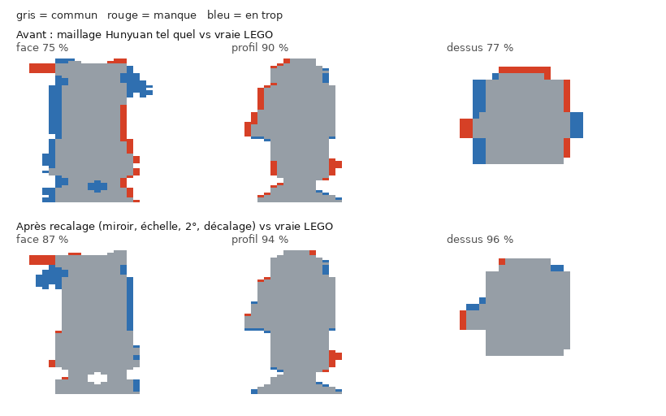
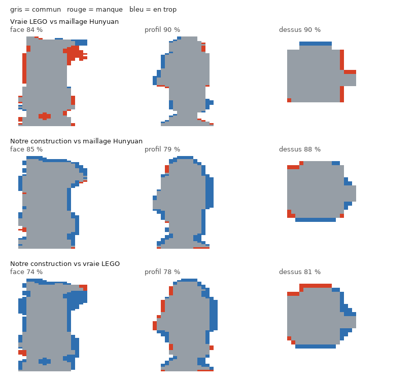

## La question
Le maillage Hunyuan de Donald a l'air presque identique à la vraie BrickHeadz, mais les scores disaient le contraire : 75 % de silhouette de face, 72 % de volume. Le maillage est-il vraiment différent, ou le mesure-t-on mal ? La vraie LEGO, posée à côté, sert de juge.

## Les deux modèles superposés
Le maillage Hunyuan recalé est coloré selon son écart à la surface des briques : rouge = en retrait, gris clair = juste, bleu = dépasse (couleur pleine à partir de 8 LDU, soit une plate). La vraie LEGO est en transparence en dessous. En survolant un point, on lit l'écart. Le mode « Texture » montre le maillage tel que Hunyuan l'a peint. [Ouvrir en grand](/research/assets/13-overlay3d.html)

<iframe src="/research/assets/13-overlay3d.html" style="width:100%;height:600px;border:1px solid var(--line);border-radius:10px" loading="lazy" title="Vraie LEGO et maillage Hunyuan superposés"></iframe>

**Ce qu'on voit :**

- En moyenne, la surface de Hunyuan est à **2 LDU (0,8 mm)** des briques, et la moitié du maillage est à moins de 2 LDU.
- Le **visage, le bec, le ventre et l'arrière de la tête** sont presque parfaits.
- **La mèche du chapeau** est la plus grosse erreur de forme. Chez LEGO, c'est une plaque à barre qui part à l'horizontale ; Hunyuan en a fait un ruban qui monte et part sur le côté.
- **Les bras et les mains** sont plus épais et plus bas chez Hunyuan, et le détail des mains est inventé.
- **Les tenons du socle** deviennent des bosses arrondies.
- **Les arêtes de la tête et l'arrière du corps** sont arrondis ou creusés chez Hunyuan, là où LEGO a des angles vifs.

Hunyuan a donc très bien compris les grands volumes. Il se trompe sur les **petits éléments rapportés** et **arrondit les angles**.

## Pourquoi les scores semblaient si bas
**1. Le maillage était mal posé.** J'ai cherché ensemble le miroir, le quart de tour, l'échelle par axe, une petite rotation et le décalage :

- **Miroir gauche/droite.** C'est un vrai bug chez nous : `from_mesh` retourne l'axe vertical (glTF → LDraw) sans retourner la profondeur. Toutes nos figurines faites depuis Hunyuan sont donc en miroir.
- **Profondeur × 1,08.** Hunyuan fait Donald trop plat d'avant en arrière.
- **Décalage d'exactement ½ tenon**, plus moins d'1° de rotation.

**2. La mesure est très sévère au bord.** Une case fait ½ tenon × ½ plate, et Donald est presque tout en peau : 38 % de ses cases touchent le bord. La vraie LEGO **décalée d'une seule case contre elle-même** ne fait que **79 %** de volume, et 81 % de silhouette de face.

**3. L'ancienne règle de remplissage gonflait les formes rondes.** Une case était pleine dès que la surface la touchait. Les faces plates d'une LEGO tombent pile sur les bords de case ; la surface arrondie de Hunyuan déborde dans la case voisine. Nouvelle règle : une case est pleine si **plus de la moitié de son volume** l'est (calcul à résolution double).

| Maillage Hunyuan vs vraie LEGO | Face | Profil | Dessus | Volume |
|---|---|---|---|---|
| Tel quel (repère actuel de `from_mesh`) | 75 % | 90 % | 77 % | 72 % |
| Recalé sur les silhouettes (ancienne règle) | 87 % | 94,5 % | 95,5 % | 87 % |
| **Recalé sur le volume (nouvelle règle)** | 92,5 % | 94,4 % | 94,3 % | **91,9 %** |

Les 8 % de volume restants sont à **90 % sur la peau**, à une case du bord : ce sont les arrondis, la mèche et les mains vus plus haut.

## En cases
Rouge = plein dans la vraie LEGO et vide chez Hunyuan ; bleu = l'inverse ; gris = commun. On peut couper à une hauteur donnée et afficher la vraie LEGO en briques par-dessus. [Ouvrir en grand](/research/assets/13-diff3d.html)

<iframe src="/research/assets/13-diff3d.html" style="width:100%;height:560px;border:1px solid var(--line);border-radius:10px" loading="lazy" title="Différence 3D en cases : vraie LEGO vs Hunyuan recalé"></iframe>

## Et notre construction ?
Même mesure, même règle qu'avant le recalage, pour la meilleure construction de la recherche très large (note 13) :

| | Face | Profil | Dessus | Volume |
|---|---|---|---|---|
| Vraie LEGO vs maillage Hunyuan | 84 % | 90 % | 90 % | 81 % |
| Notre construction vs maillage Hunyuan | 85 % | 79 % | 88 % | 70 % |
| **Notre construction vs vraie LEGO** | 74 % | 78 % | 81 % | 63 % |

- Notre construction est **trop grosse** : 7 673 cases contre 5 682 pour la vraie. Les tenons latéraux et les plaques fixées sur le côté débordent. Notre mesure interne ne le voyait pas, car elle ignorait les tenons qui dépassent.
- Elle visait le maillage en miroir.

## Les pièces : l'optimiseur n'a pas tout ce qu'il faut
La vraie Donald utilise **33 sortes de pièces** ; l'optimiseur n'en a que **19**, soit **70 pièces sur 90**. Les deux briques imprimées ont leur version sans impression. Il manque surtout trois familles :

| Famille | Pièces | Où chez Donald |
|---|---|---|
| **Arrondis** | tuile 1×1 quart de rond (25269) ×4, plaque ronde 4×4 (60474) ×2, plaque ronde 2×2 (4032) | contours de la tête, chapeau, pompon |
| **Bec** | pente courbe 1×2 (15571), plaques ailes 2×3 (43722, 43723), plaque 2×4 évidée (41740) | bec |
| **Pinces et poignées** | plaque à pince (11476, 61252), plaque à poignée (60478), tuile ronde 1×1 imprimée (98138) | yeux, détails |

Les pinces et les poignées ne sont pas seulement absentes de la liste : le moteur ne sait gérer que les accroches tenon / creux, pas pince + barre.

Sur les 101 BrickHeadz officielles, on couvre **59 sortes de pièces sur 539**, soit **72 % des pièces posées**.

Les pièces de la vraie qui tombent là où notre construction manque sont les grandes plaques 6×6 et 4×4, les briques courbes (6091), les tuiles quart de rond, les tuiles 1×4, les plaques rondes 4×4 et une plaque à poignée.

## Ce qu'on change

1. **Corriger le miroir** dans `from_mesh` et dans la vue 3D de la note 11.
2. **Une seule mesure : le volume**, avec la règle « plus de la moitié de la case ». Les silhouettes ne servent plus qu'à titre d'information.
3. **La référence, c'est la vraie LEGO.** Hunyuan recalé n'est qu'une cible intermédiaire, à laquelle la vraie LEGO elle-même ne colle qu'à 92 %.
4. **Ajouter les pièces manquantes**, d'abord celles à tenons (arrondis, bec), puis les 50 plus utilisées des officielles.
5. **Le recalage** (échelle par axe, rotation) n'est possible ici que parce qu'on a la vraie Donald. Pour une photo nouvelle, il faudra apprendre la correction moyenne en faisant passer d'autres officielles par Hunyuan.

## Fichiers

- Vues 3D : `research/assets/13-overlay3d.html` (modèles superposés) et `13-diff3d.html` (cases).
- Données : maillage recalé `13-donald-hy-fit.glb`, écarts par sommet `13-donald-hy-dist.bin`, cases `13-diff3d.json`.
