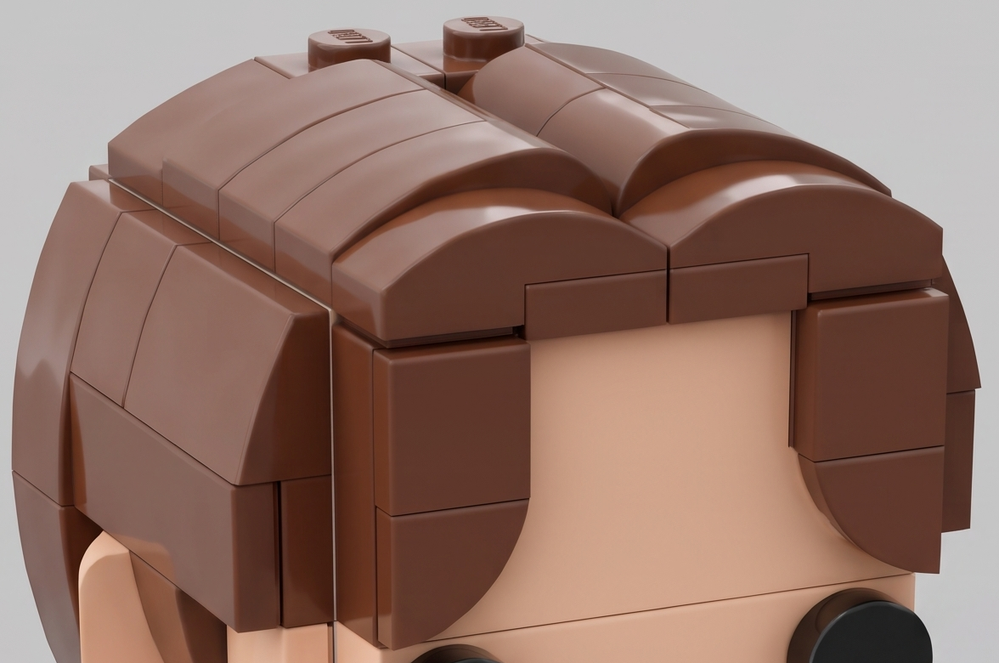
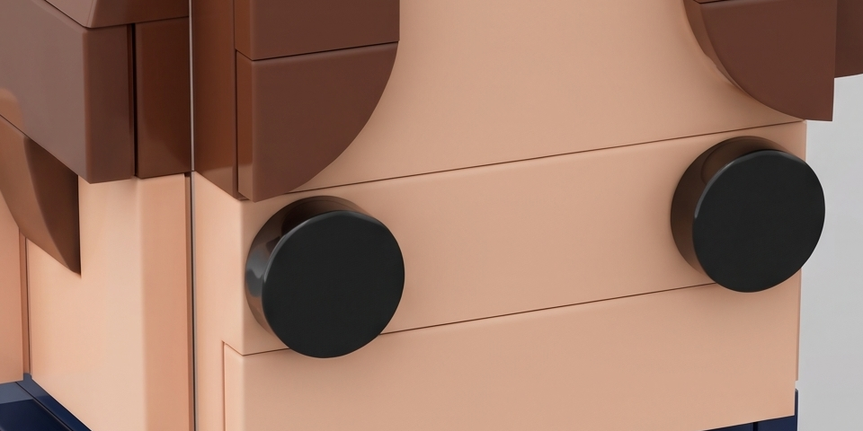
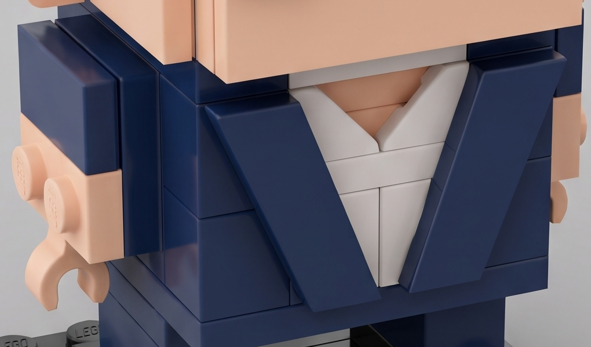
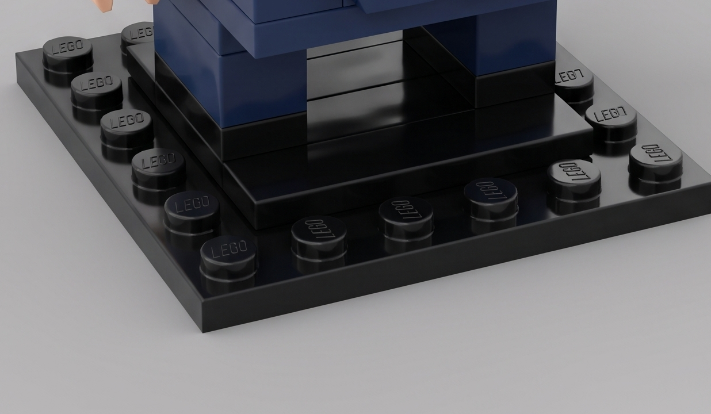

## Le défi
Reproduire cette figurine le plus fidèlement possible, avec de vraies pièces et un assemblage propre (rien ne vole, aucune collision), en zoomant sur l'image pour identifier les pièces.

<iframe src="/research/assets/17-defi.html" style="width:100%;height:600px;border:1px solid var(--line);border-radius:10px" loading="lazy" title="Image cible et figurine construite"></iframe>

[Ouvrir en grand](/research/assets/17-defi.html). Le menu permet de passer d'une version à l'autre. Les boutons donnent le même angle que l'image, la face, le profil, le dos et le dessus.

## 1. Lire l'image : zooms et pièces identifiées
| Zone | Zoom | Ce que je lis | Pièces retenues |
|---|---|---|---|
| Cheveux |  | Brun-roux. Deux rouleaux à l'avant, de part et d'autre d'une raie. Deux tenons ronds visibles au sommet. Mèches sur les côtés du visage, arrondies en bas. Côtés lisses en pentes courbes. | pentes courbes 2 × 2 (15068) et 2 × 1 (11477), quarts de rond 1 × 1 (25269), plaques d'angle (2420), plaque 2 × 4 |
| Visage |  | Chair claire, en **rangées horizontales** : c'est un visage en tuiles posées sur le côté (SNOT), comme les officielles. Les yeux sont des disques noirs unis, à peu près 1 tenon. | tuiles 1 × 1, 1 × 2 et 1 × 4 sur une plaque 4 × 4 verticale ; yeux en tuiles rondes 1 × 1 noires (98138) |
| Corps |  | Veste bleu marine, chemise blanche en V, avec un petit triangle de peau au cou. Mains couleur chair avec deux tenons et une pince. | briques 1 × 1 à tenon de face (4070), tuiles 1 × 1, quarts de rond ; mains : plaque 1 × 2 à pince (11476) |
| Socle |  | Plaque noire 6 × 6 avec une rangée de tenons sur le pourtour, et un plateau surélevé de deux plates sous les jambes. | plaque 6 × 6 (3958), plaque 1 × 4 à deux tenons (92593), tuiles 2 × 4 et 1 × 4 |

## 2. Méthode
Appliquée d'après les notes 15 et 16 : **squelette commun d'une officielle, et tout ce qui se voit refait d'après l'image.**

1. **Choisir le squelette.** Parmi les 101 officielles, Marty McFly (41611, 2ᵉ figurine) a la même construction que la cible : homme, cheveux en volume, veste ouverte sur une chemise. Je garde son noyau de tête (14 briques 22885 à tenons latéraux, cachées), le cadre du corps, les jambes et le socle.
2. **Refaire ce qui se voit**, zone par zone, d'après les zooms (voir les versions ci-dessous).
3. **Vérifier chaque version avec le moteur** : points d'accroche réels de chaque pièce, rien ne vole, aucune pièce qui en traverse une autre. Deux erreurs ont été trouvées et corrigées ainsi : une frange posée un demi-tenon trop en avant, qui volait, et une collision avec les pentes de côté des cheveux.
4. **Comparer à l'image**, sous le même angle et sous les autres vues (dessus, profil, dos).

## 3. Les versions
| Version | Changement | Pièces | Contrôle |
|---|---|---|---|
| v1 | Squelette de Marty, recoloré aux couleurs de la cible : veste et pantalon bleu marine, chemise blanche, peau chair claire, socle noir. Accessoire retiré. | 114 | rien ne vole, 0 collision |
| v2 | **Col en V** : la brique blanche de chemise devient 4 briques 1 × 1 blanches à tenon de face, avec tuiles blanches en haut et quarts de rond bleu marine en bas, qui dessinent la pointe. **Favoris** : tuiles brunes sur les bords du haut du visage, finies par un quart de rond arrondi vers l'intérieur. | 122 | rien ne vole, 0 collision |
| v3 | **Frange en deux rouleaux** : une plaque 2 × 4 brune qui déborde au-dessus du front, et deux pentes courbes 2 × 2 en relief. Le dessus est entièrement couvert (vérifié en vue de dessus). Yeux noirs unis. | 121 | rien ne vole, 0 collision |

## 4. Liste des pièces (v3)
| Pièce | | Couleur | Nb |
|---|---|---|---|
| 22885 | brique 1 × 2 × 1⅔ à tenons sur un côté (noyau de tête) | gris clair (caché) | 14 |
| 4070 | brique 1 × 1 à tenon de face | bleu marine | 12 |
| 4070 | brique 1 × 1 à tenon de face | blanc | 4 |
| 25269 | tuile 1 × 1 quart de rond | brun-roux | 9 |
| 25269 | tuile 1 × 1 quart de rond | bleu marine | 2 |
| 3023 | plaque 1 × 2 | bleu marine | 8 |
| 2420 | plaque d'angle 2 × 2 | brun-roux | 7 |
| 15068 | pente courbe 2 × 2 | brun-roux | 4 |
| 3069b / 3070b | tuiles 1 × 2 / 1 × 1 | brun-roux, bleu marine, blanc, chair | 17 |
| 11476 | plaque 1 × 2 à pince (mains) | chair claire | 2 |
| 98138 | tuile ronde 1 × 1 (yeux) | noir | 2 |
| 3958 | plaque 6 × 6 (socle) | noir | 1 |
| … | 30 autres références (plaques, pentes, tuiles) | | 39 |
| **Total** | **42 références** | | **121** |

Les fichiers `data/defi_costume/v3.ldr` (s'ouvre dans Studio ou LDCad) et `v3.json` contiennent la liste complète, avec positions et couleurs.

## 5. Ce qui reste différent de l'image
- **La raie au milieu des cheveux n'est pas faite** (remarque de Florian après coup). Le dessus est une frange d'un seul tenant, alors que l'image montre deux rouleaux séparés par une raie, de l'avant à l'arrière. On garde la v3 telle quelle : c'est le résultat en un seul essai.

- **Le col en V est arrondi**, pas pointu, et un mince filet blanc reste visible sous les revers. Les briques 1 × 1 sont plus hautes que les tuiles posées dessus ; c'est un défaut réel de ce montage. Un V net demanderait des revers en biais (charnières ou plaques à clip), que le moteur ne sait pas encore vérifier.
- **Les côtés des cheveux** gardent les pentes de Marty, moins lisses que sur l'image.
- **Le petit triangle de peau** au cou n'est pas fait.
- L'image vient de Gemini et n'est pas une vraie LEGO : certaines de ses pièces, comme les revers inclinés, n'ont peut-être pas d'équivalent exact.

## Fichiers

- Construction : `brickforge/defi_costume.py` (chaque étape est une fonction : recolor, collar, sideburns, fringe).
- Modèles : `data/defi_costume/v1.ldr`, `v2.ldr`, `v3.ldr` ; zooms et image dans `research/assets/17-*`.
